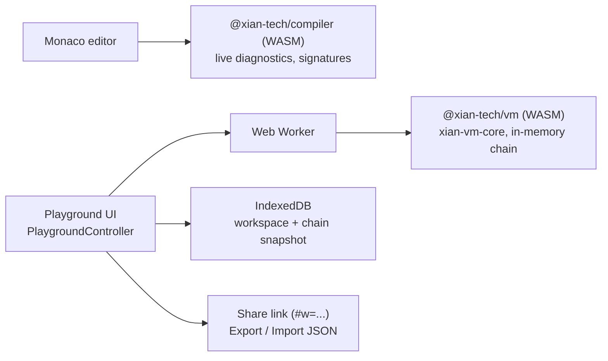

# xian-playground-web

`xian-playground-web` is the in-browser playground for Xian smart contracts.
Users write, lint, deploy and call contracts and inspect their state. Everything
runs in the browser: the contract compiler and the node's own VM are compiled
to WebAssembly, so the site is a set of static files and no contract code or
state is sent anywhere. It is a developer test surface, not a live node.

Built with Next.js (App Router, static export), TypeScript, Tailwind CSS,
shadcn/ui and the Monaco editor.

## How It Works



- **Compiler**: `@xian-tech/compiler` (`../xian-contracting/packages/xian-compiler-core/npm`)
  gives live diagnostics in the editor and the compiled VM IR from which the
  call and constructor forms are built.
- **VM**: `@xian-tech/vm` (`../xian-contracting/packages/xian-vm-core/npm`) is
  `xian-vm-core` with an in-memory store. Deploys go through the same
  `submission.submit_contract` path as on chain (the VM compiles the source).
  It runs in a Web Worker: a call that runs too long is stopped, and a VM crash
  (a Rust panic aborts the WebAssembly instance) restarts the worker from the
  last saved chain snapshot.
- **Exact values**: every contract value crosses the engine boundary as V2 wire
  JSON text. Decimals are `{"__fixed__": "1.5"}`, integers beyond 2^53 are
  `{"__big_int__": "..."}`; nothing passes through a JavaScript `number`. Form
  inputs are parsed with the VM's own rules (`canonical_decimal` is mirrored in
  TypeScript and checked against the VM's export by a differential test).
- **Workspaces**: one per browser, kept in IndexedDB (editor, environment,
  activity log, chain snapshot). Without storage the app still works for the
  current tab. Share links put the workspace in the URL fragment
  (deflate-compressed, size-capped); shared and imported workspaces carry
  contract source and public state only and are redeployed from source.

## Quick Start

The sibling WebAssembly packages must be present and built:

```text
xian/
  xian-contracting/          # packages/xian-compiler-core/npm, packages/xian-vm-core/npm
  xian-playground-web/
```

```bash
npm run build:wasm   # wasm-pack builds of the compiler and the VM (Rust + wasm32 target)
npm ci
npm run dev          # http://localhost:3000
```

Production build and local preview of the static export:

```bash
npm run build        # writes out/
npm run serve        # serves out/ on http://127.0.0.1:3210
```

## Validation

```bash
npm run lint
npm run typecheck
npm test                       # Vitest: unit, component and real-WASM tests
npm run coverage               # the same with coverage (coverage/lcov.info)
npm run build
npx playwright install chromium
npm run test:e2e               # Playwright against out/ on the real VM
```

## Hosting

`out/` is plain static files. The host should:

- serve `.wasm` as `application/wasm` (streaming compilation needs it);
- cache `/_next/static/*` (content-hashed) as `public, max-age=31536000, immutable`;
- allow `'wasm-unsafe-eval'` in the Content-Security-Policy `script-src`, and
  workers from `'self'`.

`public/_headers` carries these rules for hosts that read it (Netlify,
Cloudflare Pages). The app expects to be served from the site root.

## Key Directories

- `src/app/` — Next.js entry (`page.tsx` loads the client-only playground).
- `src/components/playground/` — panels, forms, header, Monaco setup.
- `src/components/ui/` — shadcn/ui components (owned, edit freely).
- `src/lib/values/` — strict JSON parser, wire format, exact numbers, display.
- `src/lib/contract/` — name rules, method signatures from IR, typed kwargs.
- `src/lib/engine/` — engine interface, VM adapter, worker RPC, compiler wrapper.
- `src/lib/playground/` — the controller (application state and actions),
  state documents, selection.
- `src/lib/workspace/` — workspace document, share links, persistence, log.
- `tests/unit/` — Vitest; `tests/e2e/` — Playwright.
- `scripts/serve-static.mjs` — static server for previews and e2e tests.

## Requirements

- Node.js 24 or newer (Vitest imports the WebAssembly packages natively)
- For `build:wasm`: Rust with the `wasm32-unknown-unknown` target and `wasm-pack`

## Related Docs

- [`../xian-contracting/README.md`](../xian-contracting/README.md) — compiler and VM
- [`../xian-ide-web/README.md`](../xian-ide-web/README.md) — the IDE, which uses the same compiler package
- [`../xian-docs-web/tools/playground.md`](../xian-docs-web/tools/playground.md) — the published playground docs
